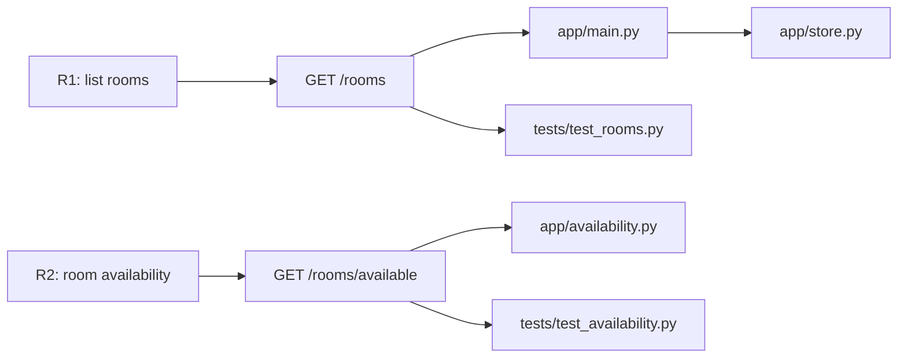

# Lightweight engineering knowledge map

This document illustrates **structured relationships** among requirements, endpoints, implementation modules and tests. It is **not** a maintained knowledge-graph database, and a mapped relationship is not proof that the requirement is currently satisfied.

| Expected behavior | Relevant implementation | Test coverage | Initial state |
|---|---|---|---|
| List rooms | `app/main.py` + `app/store.py` | `tests/test_rooms.py` | Passing |
| Reject invalid intervals | `app/main.py` | `tests/test_availability.py` | Passing |
| Enforce room capacity | `app/availability.py` | `tests/test_availability.py` | Passing |
| Adjacent intervals do not conflict | `app/availability.py` | `tests/test_availability.py` | **Intentionally failing** |

**Exercise 1:** verify in the actual source that `app/main.py` calls `available_rooms`, which calls `intervals_overlap`. Find the test paths covering the adjacent-interval requirement. Use the result to improve the instructions you will write in AGENTS.md, but **do not fix application code yet**.
